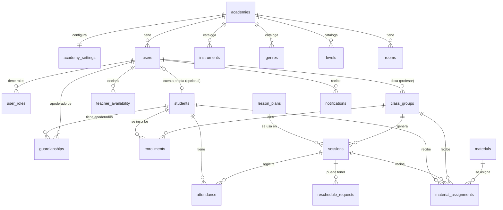

# Modelo de datos: Fase 1

El DDL ejecutable está en la migración [`apps/api/migrations/00001_initial_schema.sql`](../apps/api/migrations/00001_initial_schema.sql) (PostgreSQL 13+, extensiones `btree_gist` y `citext`). Los cambios futuros van en migraciones nuevas, nunca editando las ya aplicadas.

> **Estado:** validado contra PostgreSQL 16 (contenedor `postgres:16-alpine`). El script carga sin errores y crea 29 tablas. Se probaron a mano estas restricciones: choque de sala y de profesor (y que una sesión cancelada o adyacente no bloquea), reemplazo con titular distinto, archivo sin declaración de derechos, material con dos destinos, un solo consentimiento vigente y una sola solicitud de reagendamiento pendiente por sesión. Aún no hay pruebas automáticas ni migraciones versionadas.

## 1. Diagrama de relaciones



## 2. Tablas por área

| Área | Tablas |
|---|---|
| Academia | `academies`, `academy_settings` |
| Personas | `users`, `user_roles`, `invitations`, `students`, `guardianships`, `teacher_availability` |
| Catálogo | `instruments`, `genres`, `levels`, `rooms` |
| Clases | `class_groups`, `enrollments`, `sessions`, `closures` |
| Reemplazos | `substitution_requests` |
| Consentimientos | `consent_types`, `consents`, `pickup_authorizations` |
| Planes | `lesson_plans` |
| Reagendamiento | `reschedule_requests` |
| Asistencia | `attendance` |
| Materiales | `materials`, `material_tags`, `material_assignments` |
| Sistema | `notification_preferences`, `notifications`, `audit_log` |

## 3. Decisiones de diseño

**Multi-academia desde el día uno.** Casi todas las tablas llevan `academy_id` directo o por una relación. Así se puede vender a otras academias sin rehacer el modelo. Las consultas de la aplicación siempre deben filtrar por academia.

**Alumno distinto de usuario.** Un menor suele no tener cuenta. `students` guarda al alumno y `user_id` es opcional. Los apoderados se vinculan en `guardianships`, con la fecha de consentimiento (`consent_at`).

**Roles múltiples.** `user_roles` permite que una persona sea profesor y apoderado a la vez.

**Grupo vs. sesión.** `class_groups` describe la regla recurrente (día, hora, profesor, sala). `sessions` son las clases concretas generadas a partir de ella. Mover una clase modifica una sesión y deja intacto el grupo.

**Cero choques garantizado por la base de datos.** Dos restricciones `EXCLUDE USING gist` impiden que dos sesiones `scheduled` se superpongan en la misma sala o con el mismo profesor. Si dos personas reagendan a la vez, la segunda recibe un error de restricción que la aplicación debe traducir a un mensaje claro. No depende de que el código recuerde validar.

**Reagendamiento como flujo.** `reschedule_requests` guarda la propuesta, el motivo, quién decidió y cuándo. Un índice único parcial asegura una sola solicitud `pending` por sesión. Al aprobar, la aplicación actualiza la sesión (o crea una nueva con `moved_from_session_id`) dentro de una transacción.

**Reglas configurables.** Anticipación mínima, aprobador, tope mensual y expiración viven en `academy_settings`, no en el código.

**Materiales con un solo destino.** `material_assignments` exige, con un `CHECK`, que cada fila apunte exactamente a un grupo, una sesión o un alumno. `materials` obliga a que un archivo tenga `copyright_ack = true`.

**Fechas en UTC.** Todo `timestamptz`. La zona de la academia está en `academies.timezone` y se aplica al mostrar y al generar sesiones recurrentes.

**Auditoría.** `audit_log` registra quién movió, canceló o marcó asistencia, con detalle en `jsonb`.

## 4. Consultas clave

**Calendario de un apoderado (próximos 14 días):**
```sql
SELECT s.starts_at, s.ends_at, st.full_name AS alumno, g.name AS clase,
       r.name AS sala, t.full_name AS profesor, s.status
FROM guardianships gu
JOIN students st    ON st.id = gu.student_id
JOIN enrollments e  ON e.student_id = st.id AND e.status = 'active'
JOIN class_groups g ON g.id = e.class_group_id
JOIN sessions s     ON s.class_group_id = g.id
JOIN users t        ON t.id = s.teacher_id
LEFT JOIN rooms r   ON r.id = s.room_id
WHERE gu.guardian_user_id = :guardian_id
  AND s.starts_at >= now() AND s.starts_at < now() + interval '14 days'
ORDER BY s.starts_at;
```

**Horarios libres de una sala en un rango (huecos entre sesiones):**
```sql
SELECT lag_end AS libre_desde, starts_at AS libre_hasta
FROM (
  SELECT starts_at,
         lag(ends_at) OVER (ORDER BY starts_at) AS lag_end
  FROM sessions
  WHERE room_id = :room_id AND status = 'scheduled'
    AND starts_at >= :desde AND starts_at < :hasta
) x
WHERE lag_end IS NOT NULL AND starts_at > lag_end;
```

**Cambios usados por un alumno en el mes (para el tope):**
```sql
SELECT count(*)
FROM reschedule_requests rr
JOIN sessions s ON s.id = rr.session_id
JOIN enrollments e ON e.class_group_id = s.class_group_id
WHERE e.student_id = :student_id
  AND rr.status = 'approved'
  AND date_trunc('month', rr.decided_at) = date_trunc('month', now());
```

**Horas del mes de un alumno con cada profesor** (vistas "Alumnos" y "Mis clases"):
```sql
SELECT g.teacher_id, t.full_name,
       coalesce(sum(extract(epoch FROM s.ends_at - s.starts_at) / 60)
                FILTER (WHERE s.status = 'scheduled'), 0) AS programadas_min,
       coalesce(sum(extract(epoch FROM s.ends_at - s.starts_at) / 60)
                FILTER (WHERE s.status = 'completed'), 0) AS realizadas_min,
       coalesce(sum(extract(epoch FROM s.ends_at - s.starts_at) / 60)
                FILTER (WHERE s.status = 'cancelled'), 0) AS canceladas_min
FROM enrollments e
JOIN class_groups g ON g.id = e.class_group_id
JOIN users t        ON t.id = g.teacher_id
JOIN sessions s     ON s.class_group_id = g.id
WHERE e.student_id = :student_id
  AND e.status = 'active'
  AND s.starts_at >= :desde AND s.starts_at < :hasta
  AND s.starts_at::date >= e.started_on      -- no contar clases anteriores a la inscripción
GROUP BY g.teacher_id, t.full_name;
```
Se agrupa por el profesor **titular del grupo**, así una clase con reemplazo cuenta en la relación con el titular. Para el profesor, la consulta se filtra además por `g.teacher_id = :profesor`, de modo que nunca ve las horas del alumno con otros profesores.

**Asistencia por alumno en un período:**
```sql
SELECT st.full_name,
       count(*) FILTER (WHERE a.status = 'present') AS presentes,
       count(*) FILTER (WHERE a.status = 'absent')  AS ausentes,
       count(*) FILTER (WHERE a.status = 'late')    AS atrasos,
       count(*) FILTER (WHERE a.status = 'excused') AS justificadas
FROM attendance a
JOIN students st ON st.id = a.student_id
JOIN sessions s  ON s.id = a.session_id
WHERE s.starts_at >= :desde AND s.starts_at < :hasta
GROUP BY st.full_name
ORDER BY ausentes DESC;
```

## 5. Decisiones de las tablas agregadas para la fase 1

- **`closures`:** feriados y cierres con rango de fechas. `sessions.closure_id` enlaza las clases canceladas por un cierre, y `grants_makeup_credit` guarda la política para aplicarla en la fase 2.
- **Reemplazo de profesor:** `sessions.teacher_id` es quien dicta y `sessions.original_teacher_id` el titular. Un `CHECK` impide que sean la misma persona. `substitution_requests` cubre el caso en que el titular propone y la dirección aprueba (una pendiente por sesión).
- **Nota de sesión:** reutiliza `sessions.teacher_notes`; `notes_shared` decide si la ven los apoderados, privada por defecto.
- **Consentimientos versionados:** `consent_types` guarda el texto y la versión. Cambiar un texto crea una fila nueva y no edita la anterior. `consents` guarda cada decisión con fecha y quién la dio. Revocar completa `revoked_at` y conserva el historial. Un índice parcial permite una sola decisión vigente por alumno y tipo.
- **Retiro de menores:** `pickup_authorizations` guarda las personas autorizadas. `document_id` es un dato sensible: la aplicación solo debe mostrarlo a quien corresponde, y conviene cifrarlo antes del piloto.

## 6. Pendientes y puntos a revisar
1. **Pruebas automáticas** de estas restricciones en la integración continua (fase 0), y migraciones versionadas.
2. **Aislamiento por academia:** hoy las FKs no impiden mezclar filas de academias distintas (por ejemplo, una sesión de la academia A con una sala de la B). Se puede reforzar con FKs compuestas `(academy_id, id)` o con Row Level Security. Dejé las claves únicas `(academy_id, id)` en varias tablas como base para esto.
3. **Sesiones con alumnos individuales:** la asistencia se registra por alumno inscrito en el grupo. Si un alumno entra solo a una sesión (clase de reposición), habrá que decidir si se inscribe temporalmente o se modela aparte.
4. **Rol dentro de `user_roles`** no restringe, por ejemplo, que `teacher_id` en `class_groups` pertenezca a alguien con rol `teacher`. Se valida en la aplicación o con un trigger.
5. **Generación de sesiones recurrentes:** el generador debe omitir las fechas cubiertas por `closures` y, al crear un cierre, cancelar las sesiones ya generadas. Esa lógica vive en la aplicación, no en el esquema.
6. **Retención de datos de menores:** definir cuánto tiempo se conservan datos de alumnos dados de baja.
7. **Migraciones:** al elegir stack, convertir el script en migraciones versionadas.
